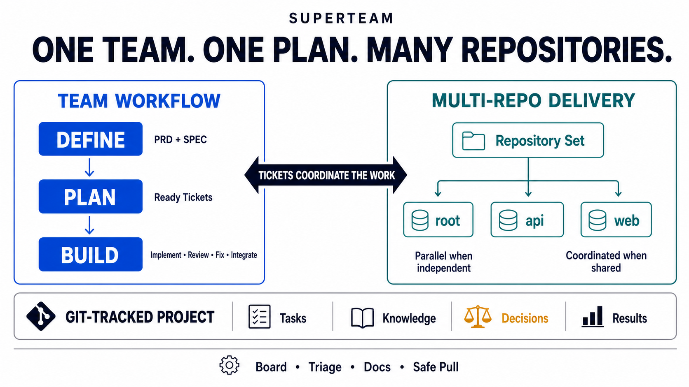
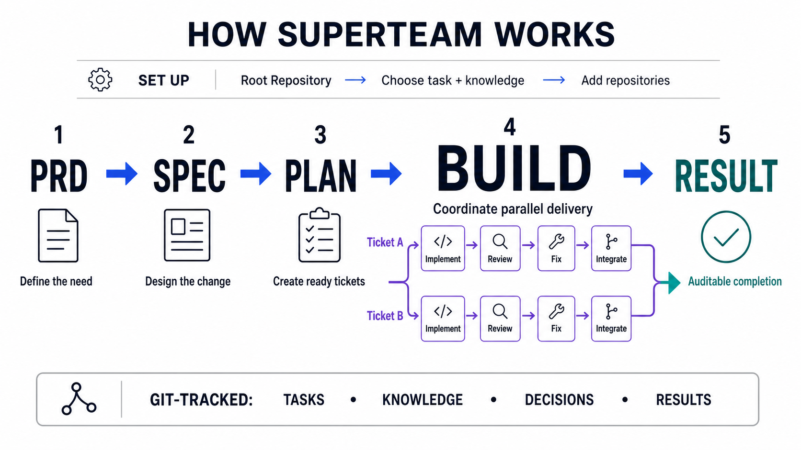

# Superteam

[English documentation](README.md)

**让一支协同工作的 AI Agent 团队，跨越一个或多个仓库交付复杂软件。**

Superteam 是面向 Codex、Claude Code 和 Qoder CLI 的 Git 原生工作流插件。
它把一个产品需求转化为团队共享的契约、可以并行推进的任务、经过独立审查的
代码，以及可以追溯的交付结果。

Superteam 为大型工程而设计：产品决策、任务、知识和进度放在一个根仓库中，
代码可以继续留在任意数量的现有仓库里。人和 Agent 始终基于同一份 Git 状态
协作。

源码：[github.com/5101good/superteam](https://github.com/5101good/superteam)



## 为什么选择 Superteam

- **团队协同。** 相互独立的任务可以并行推进；每个任务由同一个交付单元完成
  实现、审查、修复和本地集成。
- **跨仓库交付。** 一个功能可以同时修改根仓库、submodule、相邻仓库，或者
  磁盘上其他位置的仓库。
- **共享记忆。** 需求、计划、决策和结果都是由 Git 管理的普通文件，换人、换
  Agent 或中断后都能从同一个状态继续。
- **用户掌控。** Superteam 在本地工作；它不会自行 push、创建 PR 或联系远端
  服务。

## 安装

### Codex

```bash
codex plugin marketplace add 5101good/superteam
codex plugin add superteam@superteam
```

### Claude Code

```bash
claude plugin marketplace add 5101good/superteam
claude plugin install superteam@superteam
```

### Qoder CLI

```bash
qodercli plugin marketplace add 5101good/superteam
qodercli plugin install superteam@superteam
```

在 Codex 中从 `$superteam:using-superteam` 开始；在 Claude Code 和 Qoder
CLI 中使用 `/superteam:using-superteam`。直接告诉 Superteam 你想做什么，它会
选择合适的工作流。

## 创建工程

打开用于保存团队任务和知识的目录，然后告诉 Superteam：

```text
为这个工程设置 Superteam。
```

如果当前目录已经是 Git 仓库，Superteam 会直接复用；如果是空白目录，它会在
确认后创建根仓库。Superteam 还会分别确认任务和知识目录的名字，不会默认认为
`task/` 或 `knowledge/` 一定可用。

初始化后会得到一个由 Git 管理的简洁结构：

```text
superteam.yaml     工程路径与仓库列表
task/              产品契约、计划、任务和结果
knowledge/         团队共享的上下文与决策
```

目录名可以自定义。`superteam.yaml` 会记录最终选择，让每个 Agent 都看到同一个
工程。

## 使用单仓库或多个仓库

单仓库和 monorepo 都直接使用根仓库。对于多仓库工程，只需把已有仓库加入工程：

```text
把 ../api 和 ~/develop/mobile-app 加入这个 Superteam 工程。
```

相对路径、绝对路径和 `~/` 路径都可以使用。Superteam 保持各仓库相互独立，
只在 `superteam.yaml` 中保存规范化后的路径；已有 submodule 继续保持原来的 Git
结构。

每个任务都会声明自己需要修改哪些仓库。相互独立的任务可以并行；如果多个任务
涉及同一个仓库，Superteam 会协调它们的 worktree 和分支，避免互相争抢。

## 交付一个功能



可以直接使用自然语言，也可以指定工作流：

| 你想做什么 | 工作流 |
| --- | --- |
| 明确产品需求 | `superteam-prd` |
| 设计技术方案 | `superteam-spec` |
| 拆分可并行任务 | `superteam-plan` |
| 构建完整功能 | `superteam-build` |
| 实现一个就绪任务 | `superteam-implement` |
| 查看功能和任务进度 | `superteam-board` |

一个典型功能会依次经过：

```text
PRD → Spec → Plan → Build → Result
```

PRD、Spec 和 Plan 会直接写入工程。如果需要调整，继续沟通并重新运行对应工作流
即可；Plan 不会自动启动 Build。

Build 会协调所有已经就绪的任务，为每个交付单元提供完整的仓库集合，让实现、
审查和修复留在同一个单元内，并把最终结果记录到根仓库。

## 更新工程代码

只有在你明确要求拉取代码时，Superteam 才会依次检查根仓库和所有已登记仓库。
干净且具备 upstream 的仓库只执行 `git pull --ff-only`；dirty、detached、缺失或
没有 upstream 的仓库会被跳过，最终报告会说明每个仓库发生了什么。

这个操作不会 stash、rebase、强制更新、push，也不会递归更新 submodule。

## 运行环境

Superteam 运行时只需要 Git、Bash 和 POSIX 基础工具，支持 macOS、Linux 和
WSL，不依赖 Python、Node.js、`jq` 或 `yq`。

## 致谢

Superteam 的设计参考了
[Matt Pocock's skills](https://github.com/mattpocock/skills) 和
[Jesse Vincent's obra/superpowers](https://github.com/obra/superpowers)。它们在
可复用 Agent Skill、测试驱动开发和迭代式审查流程方面的实践启发了这个项目。

## 贡献与许可证

欢迎参与贡献，请先阅读 [CONTRIBUTING.md](CONTRIBUTING.md) 和
[CODE_OF_CONDUCT.md](CODE_OF_CONDUCT.md)。安全问题请按 [SECURITY.md](SECURITY.md)
说明处理。

Superteam 使用 [Apache-2.0](LICENSE) 许可证。
